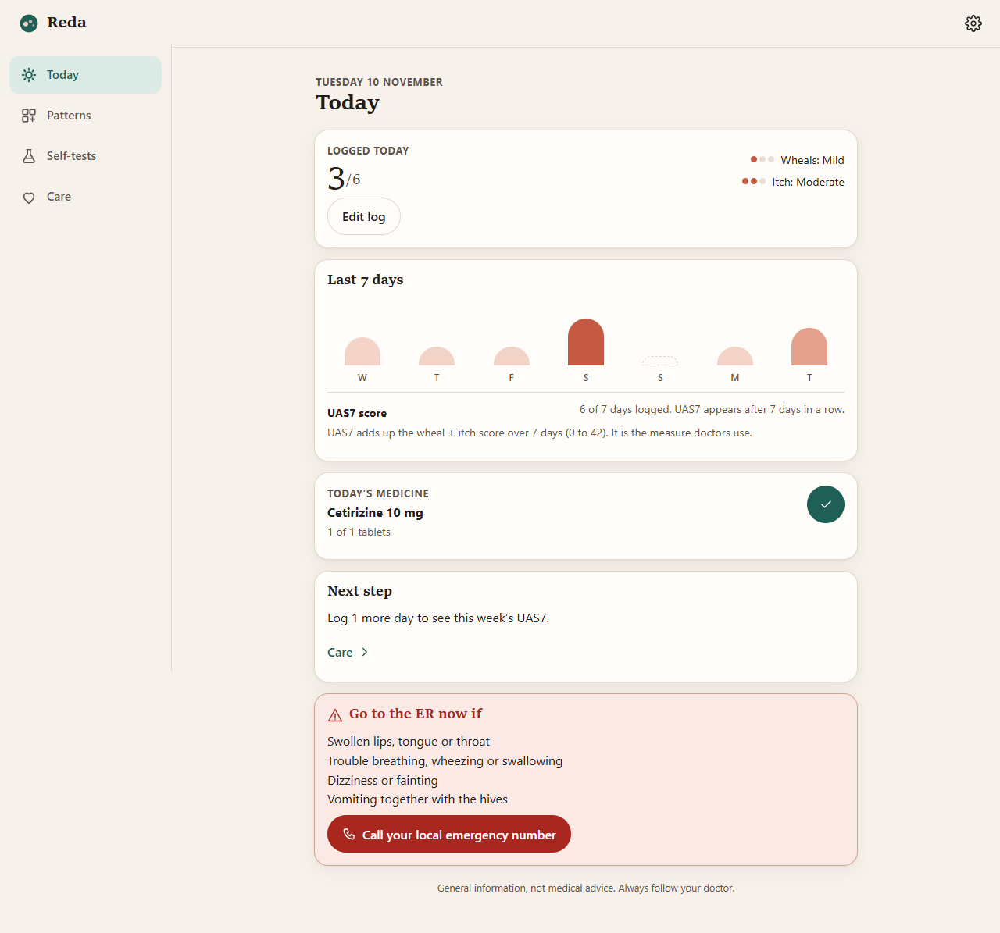

<!-- HERO:START -->
<p align="center">
  <a href="https://juw12.github.io/reda/?demo=1"></a>
</p>

<p align="center">
  <b>Reda — a daily companion for chronic hives (biduran).</b><br>
  Log in two minutes, find your triggers, test physical hives with photo references, and follow the treatment ladder with your doctor. No account; everything stays on your phone.
</p>

<p align="center">
  <a href="https://juw12.github.io/reda/?demo=1"><b>Try it live (demo data)</b></a> ·
  <a href="https://juw12.github.io/reda/">Start fresh</a> ·
  <a href="#what-it-does">What it does</a> ·
  <a href="https://github.com/juw12">More by juw12</a>
</p>

<p align="center">
  
  
  
  
</p>
<!-- HERO:END -->

## Why

In about half of people with chronic hives no trigger is ever found, and allergy tests are often negative.
What helps is (1) measuring the disease the way doctors do, (2) spotting real patterns instead of guessing,
(3) checking for physical triggers, and (4) taking a non-drowsy antihistamine every day and stepping up with
a doctor when it is not enough. Reda puts those four things in one small offline app.

## What it does

| Tab | What you get |
|---|---|
| **Hari ini / Today** | Two-question check-in (wheals 0–3, itch 0–3), a 7-day *welt ribbon*, the **UAS7** score with its band (0 / 1–6 / 7–15 / 16–27 / 28–42), today's dose ticks, and red-flag signs with a one-tap emergency call. |
| **Pola / Patterns** | Weekly UAS7 trend, 28-day calendar, and a trigger finder that compares your score on days with vs without each factor (same day and next day for foods). It only says "possible trigger" with at least 3 days on each side and a gap of 1 point or more. |
| **Tes diri / Self-tests** | Scratch (dermographism), ice cube (cold), bag strap (pressure), warm glass (heat), exercise (cholinergic) and sunlight. Step-by-step instructions, built-in timers, **reference photos of a positive result** (Wikimedia Commons, credited), safety notes, and a result log. Plus a "Is this hives?" gallery with angioedema warning signs. |
| **Rawat / Care** | Your antihistamine plan (standard adult doses), the guideline treatment ladder with *you are here*, weekly advice (log more / controlled / wait 2–4 weeks / ask about the next step), what to avoid, what calms the itch, what not to do (long-term steroids, "racikan", CTM), doctor tests and questions. |
| **Laporan / Report** | One page for your doctor: 4 weeks of UAS7, average score, swelling days, plan, possible triggers, self-test results. Print / save as PDF, copy summary, or CSV. |

Privacy: no server, no account, no analytics. Logs and photos live in `localStorage` / IndexedDB on the device; export/import a JSON backup from Settings.

## Medical basis

- Zuberbier T. et al. *The international EAACI/GA²LEN/EuroGuiDerm/APAAACI guideline for urticaria.* Allergy 2022 — UAS7 wording and bands, treatment algorithm, provocation tests.
- Sabroe R.A. et al. *BAD guidelines for the management of people with chronic urticaria 2021.* Br J Dermatol 2022.
- Ryan D. et al. *Suggested management pathway for urticaria in primary care.* Clin Transl Allergy 2022.

Reda gives general information, not a diagnosis. Up-dosing above one tablet a day, omalizumab and ciclosporin are doctor decisions; the app says so wherever they appear.

## Run locally

```bash
python -m http.server 8000      # then open http://localhost:8000/?demo=1
python tests/run_tests.py       # 48 checks: logic, flows, layout gates (needs playwright)
```

Static files only (vanilla ES modules, no build step). Design tokens and rules: [design.md](design.md).

## Credits

Reference photos: Wikimedia Commons contributors (Mysid, Nandini Velho, Allergyresearch, SecretName101, Genzpro, PKeMcG, Psixtras, Heckat, Ravn, Boussetta N. et al.) under PD / CC0 / CC BY / CC BY-SA — full links on the Settings screen and in `js/content.js`.

MIT © juw12
